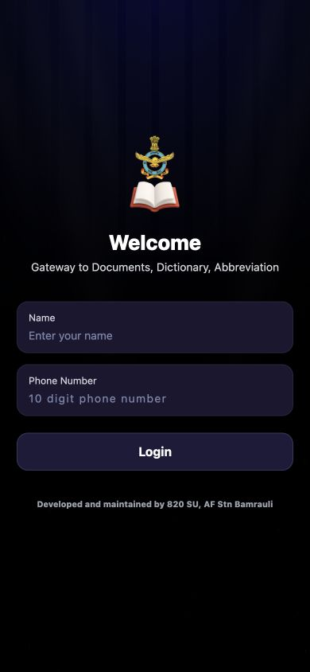
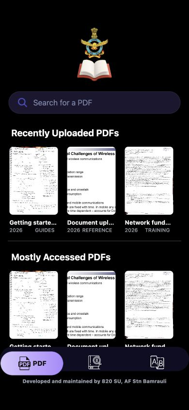
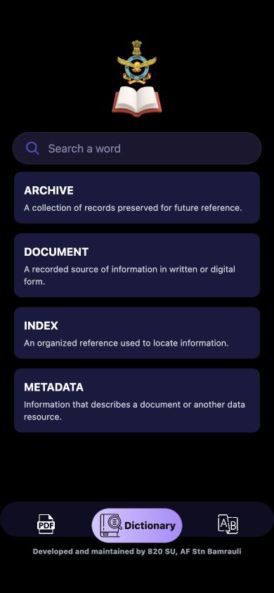
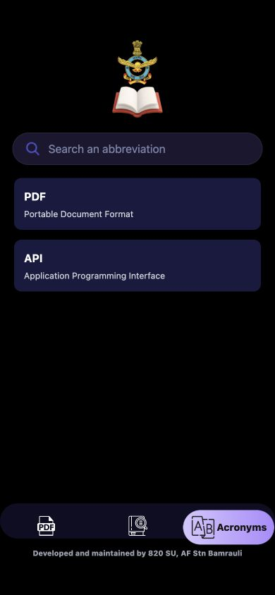
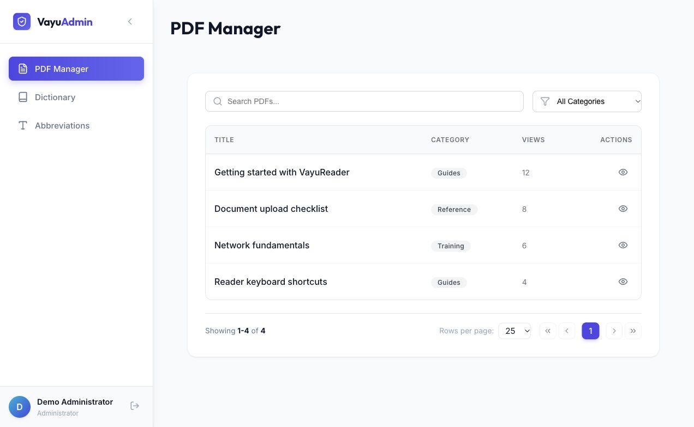
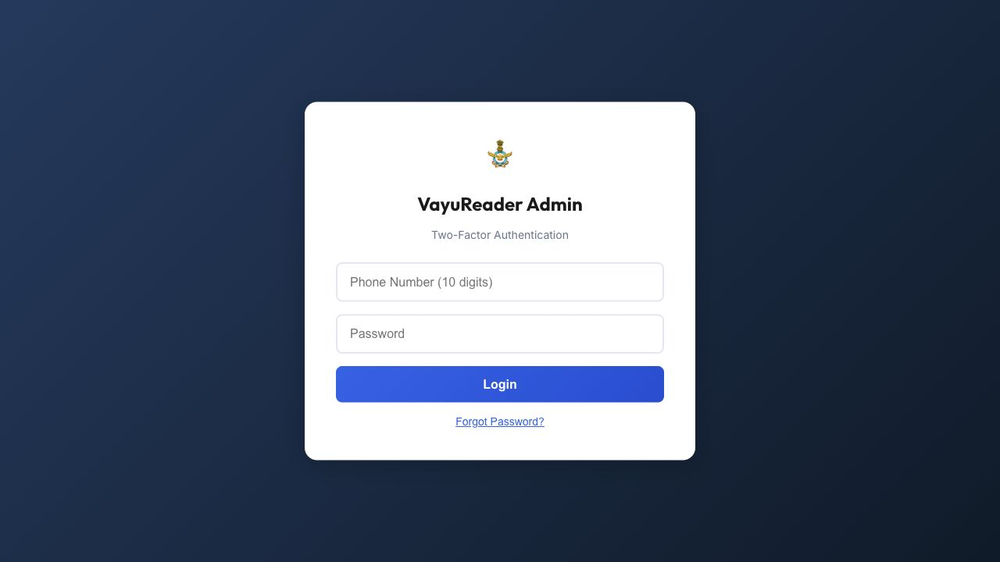
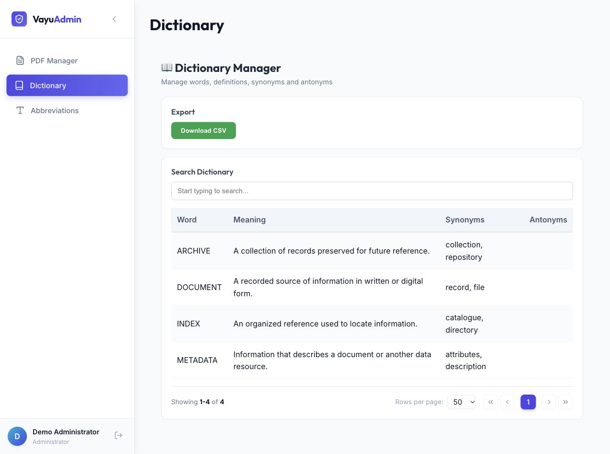
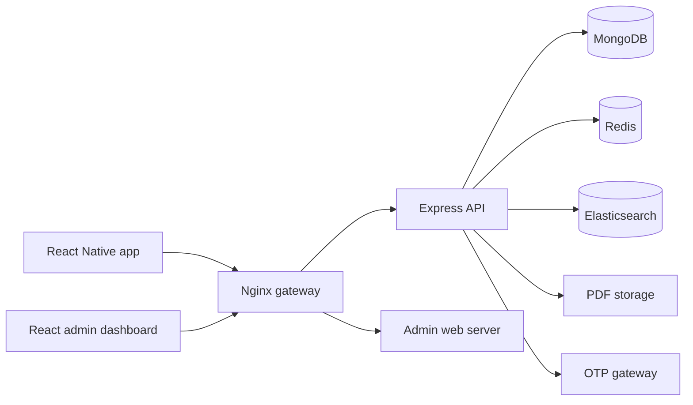

# VayuReader

A document-management platform for organizing, finding, and reading PDFs, with a React Native mobile app, a React admin dashboard, and a Node.js backend.

## Features

- **Document library:** Browse recent and frequently accessed PDFs, filter by category, and search by title.
- **In-app reading:** Open PDFs within the mobile app, with document watermarking.
- **Dictionary and acronyms:** Look up definitions and abbreviations, with paginated browsing and debounced search.
- **Content administration:** Upload and manage PDFs, maintain dictionary entries, and import structured data through the admin dashboard.
- **Access control:** OTP-based authentication, JWT sessions, role-based permissions, and device identification.
- **Upload protection:** PDF validation, security scanning, input sanitization, and authenticated document access.
- **Live updates:** Server-Sent Events notify clients when documents are added, updated, or removed.
- **Audit trails:** Administrative and user activity logs support operational investigation.

## Screenshots

Screenshots use sample data. Mobile images are browser-rendered previews of the existing React Native screens; they are not native device captures.

### Mobile app

| Sign-in | Document library |
| --- | --- |
|  |  |

| Dictionary | Acronyms |
| --- | --- |
|  |  |

### Admin dashboard



### Admin sign-in



### Admin dictionary




## Technology stack

| Layer | Technologies |
| --- | --- |
| Mobile | React Native, Expo, TypeScript, NativeWind |
| Admin dashboard | React, JavaScript, Framer Motion |
| Backend | Node.js, Express.js |
| Database | MongoDB, Mongoose |
| Caching and rate limiting | Redis |
| Search | Elasticsearch |
| Authentication | OTP, JWT, role-based permissions |
| Deployment | Docker Compose, Nginx |

This README describes the `vayureader1.1.0` branch, which uses MongoDB.

## Architecture



The backend provides authentication, document management, search, and audit APIs. Nginx routes requests to the API and dashboard, while MongoDB stores application records, Redis supports caching and rate limiting, and Elasticsearch serves search workloads.

## Getting started

### Prerequisites

- Git and Node.js 20.
- Docker with Docker Compose for the backend stack.
- OpenSSL for generating a local development certificate.
- Android Studio and an emulator/device for Android, or Xcode on macOS for iOS.
- An SMS gateway, or the bundled SMS simulator for local OTP testing.

### 1. Clone the project

```bash
git clone --branch vayureader1.1.0 https://github.com/aachintya/vayureader.git
cd vayureader
```

### 2. Configure the backend

```bash
cd vayureader
cp .env.example .env
```

Set a unique `JWT_SECRET` of at least 32 characters and configure `OTP_GATEWAY_URL` to an endpoint reachable from the API container. For the services in the included Compose stack, use:

```dotenv
MONGODB_URI=mongodb://mongo:27017/vayureader
REDIS_URL=redis://redis:6379
ELASTICSEARCH_URL=http://elasticsearch:9200
ALLOWED_ORIGINS=https://localhost
```

The optional local SMS simulator is available through `npm run sms-simulator` after installing the backend dependencies. It runs separately from the Compose stack; configure the gateway URL according to how the API container reaches your host.

### 3. Start the backend and admin dashboard

Generate a certificate for local development:

```bash
mkdir -p nginx/certs
openssl req -x509 -nodes -days 365 -newkey rsa:2048 \
  -keyout nginx/certs/server.key \
  -out nginx/certs/server.crt \
  -subj "/CN=localhost" \
  -addext "subjectAltName=DNS:localhost,IP:127.0.0.1"
```

Then start the services:

```bash
docker compose up -d --build
```

The Compose stack starts the API, admin dashboard, MongoDB, Redis, Elasticsearch, and Nginx. Configure your browser or device to trust the local development certificate before using authenticated flows.

- **Admin dashboard:** `https://localhost`
- **API base:** `https://localhost/api`
- **Health check:** `https://localhost/health`

Create the initial administrator with your own credentials:

```bash
docker compose exec app node scripts/seedAdmin.js \
  "Local Admin" "<ADMIN_PHONE>" "<STRONG_PASSWORD>"
```

### 4. Run the mobile app

From the repository root:

```bash
cd VayuReader_Frontend
npm install
cp .env.example .env
```

Set `EXPO_PUBLIC_BACKEND_URL` to a backend address reachable from your emulator or device. A physical device's `localhost` refers to the device itself. Optional service-specific URLs are documented in the [frontend setup guide](VayuReader_Frontend/README.md).

```bash
npm run android
# Or, on macOS with Xcode:
npm run ios
```

## Project structure

```text
VayuReader_Frontend/          React Native / Expo app
vayureader/
  admin-dashboard/           React administration interface
  src/                       API routes, controllers, models, and services
  scripts/                   Seeding, maintenance, and local tooling
  nginx/                     Gateway and TLS configuration
  docs/                      Backend and operational documentation
  docker-compose.yml         Local service orchestration
```

## Documentation

- [Mobile setup and backend connection](VayuReader_Frontend/README.md)
- [Backend configuration](vayureader/docs/CONFIGURATION.md)
- [API endpoints](vayureader/docs/ENDPOINTS.md)
- [Authentication](vayureader/docs/AUTH.md)
- [Architecture](vayureader/docs/HLD.md)
- [Security implementation](vayureader/docs/SECURITY.md)
